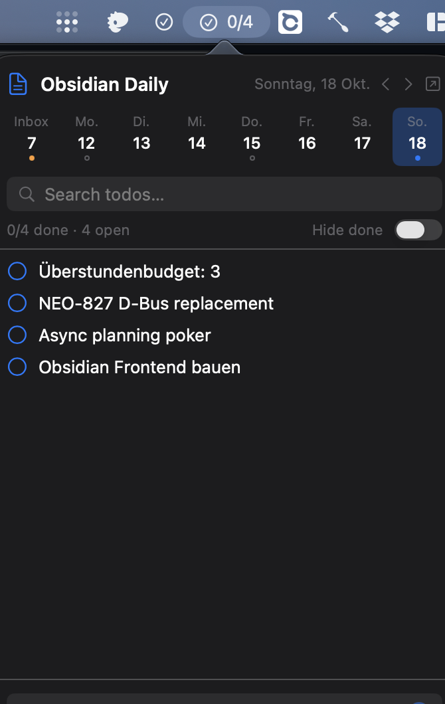

# Obsidian Daily

A macOS menu-bar app for managing Obsidian daily note todos. Built with a Go CLI backend and a SwiftUI frontend.



## Features

- **Menu-bar popover** with todos from today's daily note
- **Week strip** showing Mon--Sun with open/done indicators
- **Inbox** tab for `Inbox.md` in the vault root -- add, delete, and move todos to the current day
- **Toggle** checkboxes, **add** new todos, **delete** on hover
- **Search** and **hide done** filters
- **Day navigation** with arrow buttons
- **Open in Obsidian** button
- **File watch** for live updates when editing in Obsidian

## Requirements

- macOS 14 (Sonoma) or later
- Go 1.22+
- Swift 6.0+ (Xcode 16+)
- An Obsidian vault with the Daily Notes plugin enabled

## Setup

Set the vault path as an environment variable:

```sh
export OBSIDIAN_VAULT_ROOT="/path/to/your/vault"
```

## Build & Run

```sh
# Build the Go CLI backend
make build

# Run the SwiftUI app (development)
make app-run

# Build a standalone .app bundle
make app-bundle
```

The `app-bundle` target produces `ObsidianDaily.app` with the Go binary embedded in `Contents/Resources`.

## CLI Commands

The Go binary can also be used standalone:

```
obsidian-daily-macos status [--date YYYY-MM-DD]
obsidian-daily-macos watch
obsidian-daily-macos add --text "Buy milk" [--date YYYY-MM-DD]
obsidian-daily-macos toggle --line 5 [--date YYYY-MM-DD]
obsidian-daily-macos delete --line 5 [--date YYYY-MM-DD]
obsidian-daily-macos week [--date YYYY-MM-DD]
obsidian-daily-macos open [--date YYYY-MM-DD]
obsidian-daily-macos undo

obsidian-daily-macos inbox
obsidian-daily-macos inbox-add --text "Read article"
obsidian-daily-macos inbox-delete --line 3
obsidian-daily-macos inbox-move --line 3 [--date YYYY-MM-DD]
```

All commands output JSON to stdout.

## Project Structure

```
.
├── main.go                          # CLI command definitions
├── internal/
│   ├── config/                      # Vault + daily notes config
│   ├── status/                      # JSON snapshot types
│   ├── todo/                        # Todo parsing, mutations, inbox
│   ├── watch/                       # File watcher
│   ├── undo/                        # Undo support
│   └── open/                        # Obsidian URI launcher
├── app/                             # SwiftUI menu-bar app
│   ├── Package.swift
│   └── Sources/ObsidianDaily/
│       ├── App/                     # AppDelegate, NSStatusItem
│       ├── Models/                  # Codable structs
│       ├── Services/                # CLIService actor
│       ├── ViewModels/              # DailyViewModel
│       ├── Views/                   # SwiftUI views
│       ├── Theme/                   # Colors + fonts
│       └── Resources/               # Info.plist
└── Makefile
```
